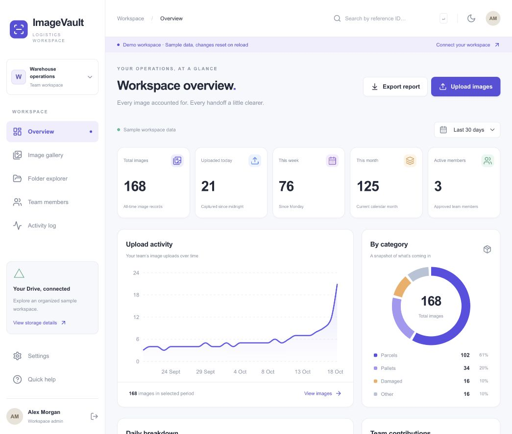
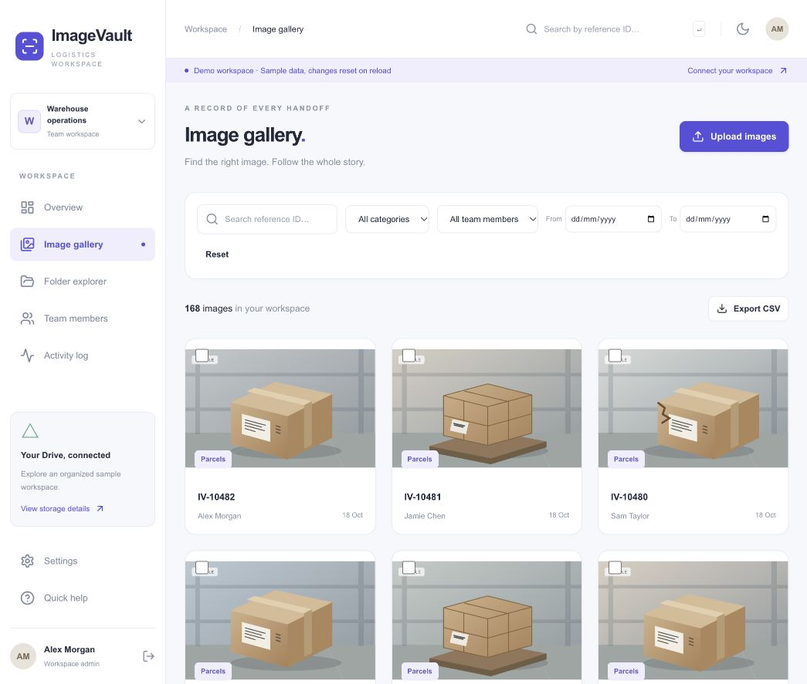
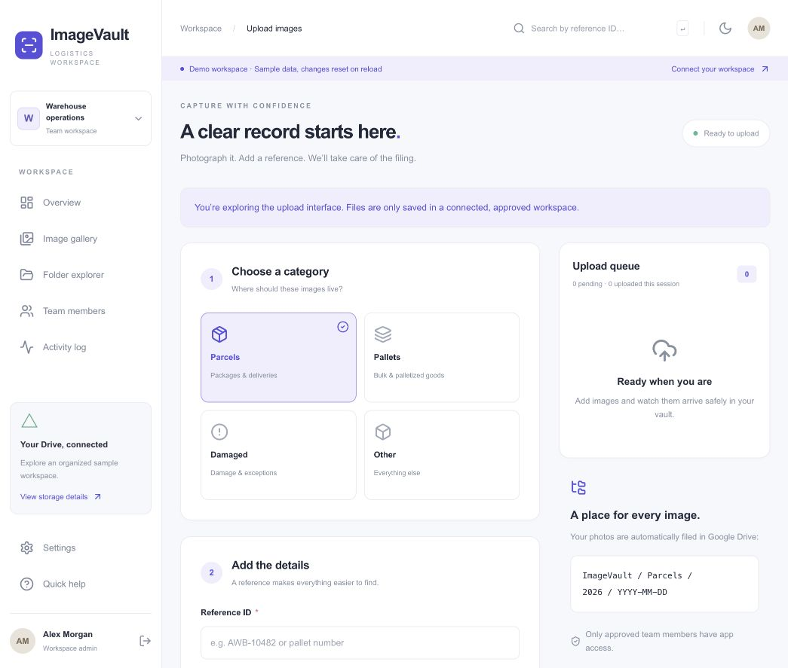
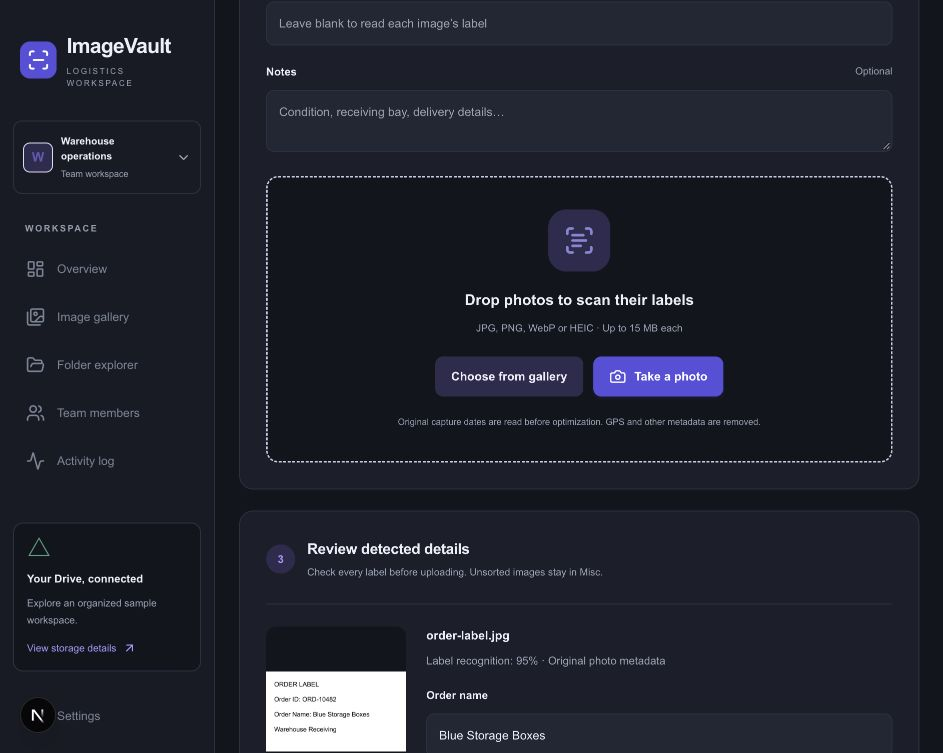
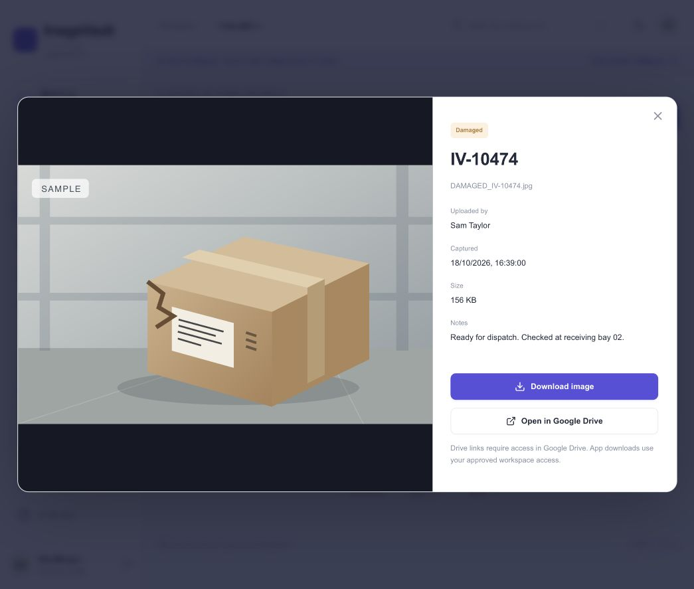

# ImageVault Logistics

A mobile-friendly warehouse photo workspace built with Next.js App Router, TypeScript, Tailwind CSS, shadcn-style Radix primitives, NextAuth, Prisma/PostgreSQL, Google Drive v3, and Recharts.

Capture parcels, pallets, damage, and other items; read order labels automatically; file gallery photos by their original capture date; review unsorted images; manage team access; and monitor uploads.

## Run the interactive demo

Requires Node.js 22.17 or newer and npm.

```sh
npm ci
npm run dev
```

Open **http://127.0.0.1:3000/demo**. No credentials or database are required for the demo. It contains 168 clearly labeled illustrated samples. Filtering, previews, smart analysis of locally selected photos, folder navigation, theme changes, and sample user/bulk operations are interactive. Demo changes reset on reload. Demo photos are analyzed on the device and are not uploaded or saved. Uploads and exports deliberately require the live workspace.

For real accounts, follow [SETUP.md](docs/SETUP.md). Credentials are not included. The Google OAuth, live Drive, and PostgreSQL flows require deployment-environment integration testing before production use.

## Screenshots

These are actual screenshots of the local demo, not screenshots of a connected production vault.

### Dashboard



### Gallery



### Upload workflow



### Smart photo review



### Image details



## Staff usage

1. Sign in with Google. Read the access explanation before consenting.
2. Wait for an administrator to approve your account. Use **Check approval status** to refresh.
3. Open **Upload**, choose a category, optionally enter an order/reference hint, and add any notes.
4. Choose one or more images from the gallery, drag images onto the drop zone, or use **Take a photo** on mobile. Original files may be JPG, PNG, WebP, HEIC/HEIF and up to 15 MB each.
5. ImageVault reads EXIF capture metadata before optimization and runs browser-local OCR to suggest the order name and reference. Review every suggestion. Gallery photos with a reliable original date are filed under that date; camera photos use the capture time from the current camera action.
6. Photos without a reliable date or usable order details are filed in **Misc** for an administrator to sort. ImageVault converts accepted images to JPEG, scales them to at most 1920 pixels, removes original metadata, and compresses to under 3 MB for transport. Unsupported HEIC variants show an error; export those to JPEG on your device.
7. Watch per-image upload progress. Failed items have a **Retry** button. Each queue item retains its idempotency ID.
8. Open **My uploads** to browse your history and filter by reference, category, upload date, folder date, or folder status. Preview metadata and download images you uploaded.

Queued photos are stored in this browser’s IndexedDB, scoped to your account. While the upload page remains open, offline items resume automatically on reconnect. After closing the page, sign in as the same user and reopen Upload to resume. Clearing browser storage deletes unsent items. Remove pending images before handing a shared device to another person. The app does not upload in the background after the tab is closed, and sensitive pages/media are never service-worker cached.

## Administrator usage

- **Overview:** all-time/today/week/month totals and active members. The selected range controls charts and daily breakdown, not these labeled KPI periods. Weeks start Monday in the configured timezone.
- **Image gallery:** filter across all users, including **Misc · unsorted**, preview smart metadata, correct an order name/reference, export filtered CSV, or select up to 30 records to download as ZIP, move into a date folder, return to Misc, or move to Drive trash. ZIP requests are capped at 3 MB combined image data for the Vercel deployment profile. Larger selections can be downloaded individually.
- **Folder explorer:** Category → Year → Date plus a shared **Misc** folder, with roll-up image counts and Google Drive folder links. Admins can create missing date folders directly.
- **Team members:** approve pending users, disable access, or promote members. You cannot change your own access; the vault owner must remain an active administrator.
- **Activity log:** paginated records for uploads, deletions, moves, and role/status changes.
- **Settings:** account details, theme, storage layout, and configured timezone.

A disabled account loses API access on its next request, even with an existing session. A request already in progress may finish. The first email in `ADMIN_EMAILS` bootstraps the admin on its first login. Subsequent emails are not automatically approved or promoted. Changing this variable does not rewrite existing users.

## Storage architecture

This is a **single-organization, central-owner vault**. `DRIVE_OWNER_EMAIL` designates an active admin whose encrypted Google refresh token is used for all Drive operations. It defaults to the first `ADMIN_EMAILS` entry. That admin must sign in first and grant Drive access. All users grant the requested OAuth scopes, but staff tokens are not used to scatter files across personal drives.

```text
ImageVault/
  Misc/                        # Images waiting for an admin to sort
  Parcels/                     # Pallets, Damaged, Other
    2026/
      2026-10-18/
        PARCELS_Blue_Storage_Boxes_AWB-10482_142530_Alex_Morgan.jpg
```

Gallery images use trustworthy EXIF `DateTimeOriginal` metadata for the proposed folder date. Direct camera captures use the time of the camera action. ImageVault does not treat file modification time as a capture date. If no reliable date exists, the image goes to `ImageVault/Misc`. The server validates all client suggestions and stores the capture source, local timestamp and offset for review. A retry uses the originally reserved server timestamp. Drive IDs, not names, identify images, so same-second filenames do not overwrite one another.

Staff can access their own files through the authenticated app. Google Drive links require separate Google Drive permissions; the app does not automatically share the owner’s Drive with staff. Admins see all app records. Do not manually rename, move, or trash vault folders outside the app without reconciling metadata.

## Project structure

```text
src/app/                     App Router pages, auth/API routes, global styles
src/components/              Dashboard, gallery, upload, management screens
src/components/ui/           shadcn-style Button and Radix Dialog primitives
src/lib/auth.ts              OAuth, account bootstrap, server authorization
src/lib/crypto.ts            AES-256-GCM refresh-token encryption
src/lib/drive.ts             Drive requests, backoff, folder cache/discovery
src/lib/api.ts               Validated API handlers, reports, bulk operations
src/lib/photo-analysis.ts    Client-only EXIF parsing and OCR orchestration
src/lib/photo-intelligence.ts Capture-date and order-label decision rules
src/lib/upload-body.ts       Bounded multipart stream reader
src/lib/naming.ts            Safe names, timezone/date ranges, CSV escaping
src/lib/queue.ts             Account-scoped persistent browser upload queue
src/lib/demo.ts              Isolated client-only example records
src/middleware.ts            Authentication boundary; handlers recheck access
prisma/schema.prisma         Models and indexes
prisma/migrations/           Initial SQL migration and deny-by-default RLS
public/                      PWA manifest, icon, non-caching service worker
tests/                       Folder, photo intelligence, security and API utility tests
```

## API

All endpoints except NextAuth’s sign-in callbacks require an active approved session. Admin-only endpoints also enforce role checks on the server. Non-GET custom API requests require a matching `Origin` header.

| Endpoint                        | Access / behavior                                                                                                            |
| ------------------------------- | ---------------------------------------------------------------------------------------------------------------------------- |
| `POST /api/upload`              | Active user; validated multipart image, category, reviewed order/capture metadata, notes, request UUID and matching uploader |
| `GET /api/images`               | Own images for users, all for admins; supports order/reference, category, user, upload/folder date and Misc filters          |
| `GET /api/images/:id/thumbnail` | Authorized image preview                                                                                                     |
| `GET /api/images/:id/download`  | Authorized original optimized JPEG                                                                                           |
| `DELETE /api/images/:id`        | Admin; soft-delete metadata and trash in Drive                                                                               |
| `PATCH /api/images/:id`         | Admin; correct order name/reference and rename the Drive file                                                                |
| `POST /api/images/bulk`         | Admin; delete, move to a category/date folder, or return records to Misc                                                     |
| `GET /api/stats/summary`        | Admin; KPIs and filtered day/category/user aggregates                                                                        |
| `GET /api/stats/daily`          | Admin; same report payload, including daily rows                                                                             |
| `GET /api/folders/tree`         | Admin; path-ordered folder records with image counts                                                                         |
| `POST /api/folders`             | Admin; create a category/date folder when it does not exist                                                                  |
| `GET /api/export/csv`           | Admin; image filters; maximum 10,000 rows                                                                                    |
| `POST /api/export/zip`          | Admin; `{ ids }`, maximum 30 items / 3 MB                                                                                    |
| `GET /api/admin/users`          | Admin; safe user fields and upload counts, never tokens                                                                      |
| `PATCH /api/admin/users`        | Admin; `{ id, role?, status? }`                                                                                              |
| `GET /api/activity?page=1`      | Admin; 50 audit events per page                                                                                              |
| `GET /api/me`                   | Safe current-user fields and workspace timezone                                                                              |

## Quality and verification

```sh
npm test
npm run typecheck
npm run build
npm run format:check
```

Automated coverage includes exact folder structure and parent IDs, Misc routing, real EXIF fixture parsing, capture-source rules, OCR label extraction and ambiguity handling, cache recovery, non-retryable Drive errors, filename sanitization, local year boundaries, 23/25-hour DST days, CSV formula protection, authenticated encryption and tamper detection, member isolation, admin enforcement, cross-origin rejection, invalid date ranges, and bounded multipart streams.

See [TESTING.md](docs/TESTING.md) for live acceptance checks and remaining verification limits.

## Production operational limits

- Google Drive and PostgreSQL do not provide a shared distributed transaction. Uploads reserve a stable Drive ID and timestamp, hash the payload, serialize folder mutations with a database advisory lock, and recover completed Drive uploads on retry. Delete/move requests attempt compensation when their database writes fail; an abrupt process crash can still leave a mismatch. Review Drive and metadata after interrupted destructive operations. A fully durable reconciliation worker is a future hardening step, not included here.
- Bulk operations commit per image. If an item fails, earlier successful items remain changed; refresh and retry the remaining selection.
- The single-vault advisory lock prioritizes correctness over peak throughput. High-volume sites should add a durable job queue and operation reconciliation before scaling.
- `drive.file` limits access to app-created/opened files. Existing arbitrary Drive folders are not imported. The central owner’s storage quota applies.
- The service worker supports installation/lifecycle only. It deliberately does not cache authenticated pages or create background sync jobs.
- The custom CSP allows inline scripts for Next.js hydration and inline styles for charts; it is not a nonce-based strict CSP. HTTPS, deployment secret handling, database backup/restore, and live OAuth validation remain deployment responsibilities.
